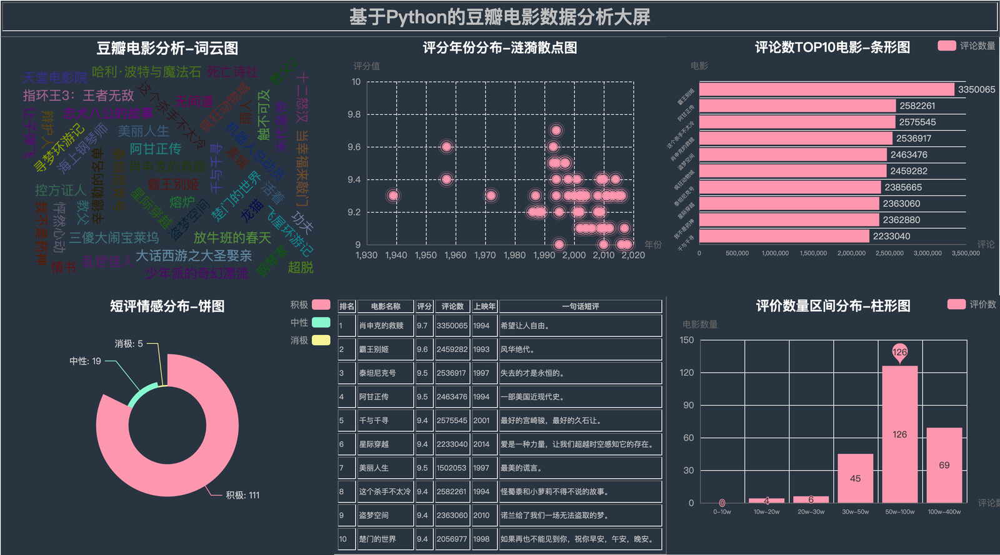
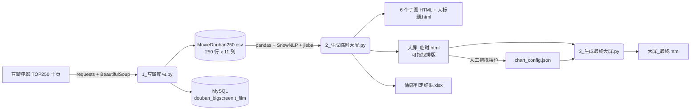

# 基于Python的豆瓣电影数据分析大屏

> 一个「数据采集 → 情感分析 → 可视化大屏」的 Python 全链路教学 / 作品集项目

[](https://www.python.org/)
[](https://github.com/pyecharts/pyecharts)
[](https://github.com/isnowfy/snownlp)
[](https://github.com/fxsjy/jieba)
[](https://www.mysql.com/)
[](LICENSE)

---

## 📖 项目简介

本项目用 **requests + BeautifulSoup** 抓取豆瓣电影 TOP250 十页数据（每页 25 部，共 250 部），解析出 11 个字段并落地为 CSV 与 MySQL；再用 **SnowNLP** 对短评做情感三档判定、用 **jieba + 自定义停用词** 做电影名称词云；最后用 **pyecharts** 生成 7 个可视化组件，借助 `DraggablePageLayout` 拖拽排版 + `save_resize_html` 套版，产出**单文件 HTML 大屏**，浏览器打开即可查看。

全链路三个脚本、一条命令跑通，代码 100% 原创。适合作为 **Python 爬虫 / 数据分析 / 数据可视化** 的练手项目或求职作品集。

---

## 🖼️ 大屏效果



> 🌐 **在线预览**：<https://mashukui.github.io/douban_bigscreen/>
>
> ⚠️ 大屏通过公网 CDN 加载 echarts / jQuery，**请在联网环境下打开**，离线会白屏（详见 [常见问题](#-常见问题)）。

---

## 🎨 多主题效果

pyecharts 内置多套配色主题，切换整套大屏配色只需改 `2_生成临时大屏.py` 顶部的一行：

```python
theme_config = ThemeType.CHALK   # 可选 CHALK / DARK / ESSOS / PURPLE_PASSION / ROMANTIC ...
```

下图是**同一份数据**在 5 种主题下的实际渲染效果（点击图片可查看大图）：

| CHALK（脚本默认） | DARK |
|:---:|:---:|
| [](screenshot/theme-chalk.png?v=2) | [](screenshot/theme-dark.png?v=2) |
| **ESSOS** | **PURPLE-PASSION** |
| [](screenshot/theme-essos.png?v=2) | [](screenshot/theme-purple-passion.png?v=2) |
| **ROMANTIC** | |
| [](screenshot/theme-romantic.png?v=2) | |

主题色板由 ECharts theme 定义，完整可选值见 `pyecharts.globals.ThemeType`。

各主题的主色板（数值为运行时从 `chart.getOption()` 实际读取）：

| 主题 | 背景色 | 主色板 |
|---|---|---|
| `CHALK` | `rgba(41,52,65,1)` | `#fc97af` `#87f7cf` `#f7f494` `#72ccff` `#f7c5a0` … |
| `DARK` | `#100C2A` | `#4992ff` `#7cffb2` `#fddd60` `#ff6e76` `#58d9f9` … |
| `ESSOS` | `rgba(242,234,191,0.15)` | `#893448` `#d95850` `#eb8146` `#ffb248` `#f2d643` … |
| `PURPLE_PASSION` | `rgba(91,92,110,1)` | `#9b8bba` `#e098c7` `#8fd3e8` `#71669e` `#cc70af` … |
| `ROMANTIC` | `#f0e8cd` | `#fb2831` `#fd948c` `#f1d1d2` `#8fcbf0` `#c4e7f7` … |

> `DARK` 是 ECharts **内置主题**，不额外请求资源；其余 4 套需联网加载对应的 `themes/*.js`。
>
> 📌 上述 5 张效果图取自 2022 年初版成品（榜单数据与版式为当时的快照），**主题配色与当前脚本一致**。上方的[大屏效果](#-大屏效果)则是当前版式 + 最新数据，用的正是脚本默认的 `CHALK` 主题。

---

## ⚙️ 功能概览

| 模块 | 说明 |
|---|---|
| 数据采集 | `requests` + `BeautifulSoup` 抓取豆瓣 TOP250 十页，解析 11 个字段 |
| 数据存储 | 落地 `MovieDouban250.csv`（UTF-8-SIG），并通过 SQLAlchemy `to_sql` 写入 MySQL 库 `douban_bigscreen` 表 `t_film` |
| 情感分析 | `SnowNLP` 对短评打分：< 0.4 消极 / 0.4~0.6 中性 / > 0.6 积极 |
| 词云生成 | `jieba` 分词 + 自定义停用词表 `hit_stopwords.txt`（767 条），绘制电影名称词云 |
| 可视化大屏 | `pyecharts`（CHALK 主题）7 个组件：大标题、TOP10 数据表格、词云、评论数条形图、情感饼图、评价数区间柱形图、评分年份涟漪散点图 |
| 拖拽排版 | `DraggablePageLayout` 可视化拖拽 → 存 `chart_config.json` → `save_resize_html` 套版，实现**一次排版、多次复用** |

---

## 🔧 实现原理

整个项目是一条**三步流水线**：

| 步骤 | 脚本 | 作用 |
|---|---|---|
| 1 | `1_豆瓣爬虫.py` | 抓取 TOP250 十页 → 解析 11 字段 → 写 CSV（`utf_8_sig`）→ 导入 MySQL |
| 2 | `2_生成临时大屏.py` | pyecharts 生成 7 个组件 → 输出 6 个子图 HTML、`大标题.html`、`大屏_临时.html`（可拖拽）与 `情感判定结果.xlsx` |
| 3 | `3_生成最终大屏.py` | 读取 `chart_config.json` 中的拖拽坐标 → `Page.save_resize_html` 套回 → 输出 `大屏_最终.html` |



**7 个可视化组件**：

| 组件 id | 图表 | 类型 | 数据依据 |
|---|---|---|---|
| `title1` | 大屏标题 | Table | 固定文案 |
| `wc1` | 豆瓣电影分析-词云图 | WordCloud | `filmname` |
| `bar_cmt1` | 评论数TOP10电影-条形图 | Bar | `filmname` × `comments` |
| `scatter1` | 评分年份分布-涟漪散点图 | EffectScatter | `showtime` × `score` |
| `pie1` | 短评情感分布-饼图 | Pie | `分析结果` |
| `table1` | TOP10电影表格数据 | Table | `rank / filmname / score / comments / showtime / comment` |
| `bar_cmt2` | 评价数量区间分布-柱形图 | Bar | `comments` 分区间计数 |

---

## 📁 项目结构

```
douban_bigscreen/
├── 1_豆瓣爬虫.py                    # 步骤 1：爬取 + 存 CSV + 入库
├── 2_生成临时大屏.py                # 步骤 2：生成 7 个组件 + 临时大屏
├── 3_生成最终大屏.py                # 步骤 3：套用拖拽排版，输出最终大屏
├── chart_config.json                # 拖拽排版坐标（步骤 3 必需）
├── hit_stopwords.txt                # 词云停用词表（767 条）
├── MovieDouban250.csv               # 数据：250 部电影 × 11 字段
├── 情感判定结果.xlsx                # 数据：CSV + 情感得分 + 分析结果
├── 大屏_最终.html                   # 成品：最终大屏（浏览器直接打开）
├── index.html                       # GitHub Pages 入口（内容同大屏）
├── screenshot/
│   ├── dashboard.png                # README 效果图（当前版式 + 最新数据）
│   └── theme-*.png                  # README 主题效果图（5 种主题配色）
├── 基于Python的豆瓣电影舆情分析系统 可视化大屏设计方案.xmind   # 设计稿
├── 思维导图2.png                    # 设计稿导出图
├── requirements.txt
├── LICENSE
└── README.md
```

> `大标题.html`、6 个子图 HTML、`大屏_临时.html` 属于**可再生的中间产物**，每次运行脚本都会重新生成，故未纳入仓库。

---

## 🚀 快速开始

### 1. 克隆项目

```bash
git clone https://github.com/mashukui/douban_bigscreen.git
cd douban_bigscreen
```

### 2. 创建虚拟环境（建议 Python 3.13）

```bash
python -m venv .venv
source .venv/bin/activate        # Windows: .venv\Scripts\activate
```

### 3. 安装依赖

```bash
pip install -r requirements.txt
```

### 4. 准备 MySQL

```sql
-- 用 root 登录 MySQL 后执行
CREATE DATABASE IF NOT EXISTS douban_bigscreen
  DEFAULT CHARACTER SET utf8mb4 COLLATE utf8mb4_general_ci;
```

> 表结构无需手动创建 —— 脚本用 `pandas.to_sql(..., if_exists='replace')` 自动建表。
>
> ⚠️ **首次运行前，请把 `1_豆瓣爬虫.py` 里的数据库连接信息改成你自己的**（host / 用户名 / 密码 / 库名）。

### 5. 运行爬虫（步骤 1）

```bash
python 1_豆瓣爬虫.py
```

产出：`MovieDouban250.csv`（同时写入 MySQL 表 `t_film`）

### 6. 生成临时大屏（步骤 2）

```bash
python 2_生成临时大屏.py
```

产出：6 个子图 HTML、`大标题.html`、`大屏_临时.html`、`情感判定结果.xlsx`

### 7. 拖拽排版并生成最终大屏（步骤 3）

```bash
# ① 浏览器打开 大屏_临时.html，拖动 / 缩放各图到满意位置
# ② 点击左上角「Save Config」下载 chart_config.json，覆盖项目根目录的同名文件
# ③ 运行：
python 3_生成最终大屏.py
```

产出：`大屏_最终.html` —— **联网状态**下用浏览器打开即可查看。

---

## 📊 输出字段说明

### MovieDouban250.csv（250 行 × 11 列，UTF-8-SIG）

| 字段 | 含义 | 示例 |
|---|---|---|
| `rank` | 排名 | 1 |
| `filmname` | 电影名称 | 肖申克的救赎 |
| `url` | 豆瓣链接 | `https://movie.douban.com/subject/1292052/` |
| `score` | 评分 | 9.7 |
| `comments` | 评论人数 | 3350065 |
| `directors` | 导演 | 弗兰克·德拉邦特 Frank Darabont |
| `actors` | 主演 | 蒂姆·罗宾斯 Tim Robbins / … |
| `showtime` | 上映年份 | 1994 |
| `areas` | 地区 | 美国 |
| `genres` | 类型 | 犯罪 剧情 |
| `comment` | 一句话短评 | 希望让人自由。 |

### 情感判定结果.xlsx（250 行 × 13 列）

前 11 列同上，另加 2 列：

| 字段 | 含义 | 规则 |
|---|---|---|
| `情感得分` | SnowNLP 情感极性分 | 0 ~ 1 |
| `分析结果` | 情感档位 | < 0.4 消极 / 0.4~0.6 中性 / > 0.6 积极 |

---

## 📈 数据说明

数据快照为**豆瓣电影 TOP250 榜单**（共 250 部）：

| 指标 | 数值 |
|---|---|
| 评分区间 | **8.4 ~ 9.7** |
| 评论人数区间 | **17.1 万 ~ 335 万** |
| 评论数榜首 | 《肖申克的救赎》约 **335 万** 条 |
| 上映年份区间 | 1931 ~ 2023 |
| 类型 TOP（标签出现次数） | 剧情 185、爱情 55、喜剧 54、冒险 50 |
| 地区 TOP（标签出现次数） | 美国 141、英国 38、日本 35、中国香港 30、中国大陆 26 |
| 短评情感分布 | **积极 111 / 中性 19 / 消极 5**（有效短评 135 条） |

> **数据缺口说明**（均为源站现象，非抓取错误）：
> - 短评 **115 条为空** —— 豆瓣电影页面对部分影片不渲染「一句话短评」。
> - 主演 **4 条为空** —— 页面本身未列出主演信息。
> - 一部电影可能有多个类型 / 地区标签，故上表按**标签出现次数**统计，合计大于 250。

---

## ❓ 常见问题

<details>
<summary><b>1. 打开大屏是白屏 / 图表不显示？</b></summary>

本项目生成的 HTML 通过**公网 CDN**（`assets.pyecharts.org`）加载 echarts / jQuery，**离线环境会白屏**。

解决办法：联网后刷新；或把 CDN 资源下载到本地，修改 HTML 中的 `<script src>` 指向本地路径。
</details>

<details>
<summary><b>2. 为什么有 115 条短评为空？</b></summary>

豆瓣电影页面对部分影片不渲染「一句话短评」，抓取时该字段自然为空，属于**源站数据现象**，不是程序 Bug。脚本已用空值兜底，情感分析会自动跳过这些行。
</details>

<details>
<summary><b>3. 抓不到数据 / 报错，怎么排查？</b></summary>

常见原因是**豆瓣页面改版导致 CSS 选择器失效**，或触发反爬。

排查路径：① 用浏览器 F12 核对选择器是否变化并更新；② 补全 `User-Agent`；③ 适当增大请求间隔、降低抓取频率。**请勿高频抓取**，遵守目标站点规则。
</details>

<details>
<summary><b>4. 提示 pandas 相关报错？</b></summary>

`pandas` 不同大版本存在 API 变动。本项目已在 **pandas 3.0.1** 环境实测通过，`requirements.txt` 中约束为 `pandas>=2.2`，按文件安装即可。
</details>

<details>
<summary><b>5. 我重新拖拽排版后，最终大屏没有变化？</b></summary>

步骤 3 的套版依赖 `chart_config.json`，请确认：

1. 在 `大屏_临时.html` 里拖好位置后，点 **Save Config** 下载新的 config；
2. 用新文件**覆盖项目根目录**的 `chart_config.json`；
3. 若你改动了图表变量名 / id，还需同步修改 json 中的 `cid`；
4. 再运行 `python 3_生成最终大屏.py`。

这样即可「一次排版、多次复用」。
</details>

<details>
<summary><b>6. 词云里出现大量无意义符号？</b></summary>

停用词表 `hit_stopwords.txt` 已内置 767 条中英文停用词。如需定制，直接往该文件追加你自己的停用词即可。
</details>

<details>
<summary><b>7. 怎么切换大屏的配色主题？</b></summary>

改 `2_生成临时大屏.py` 顶部的 `theme_config`，然后重跑步骤 2、3 即可：

```python
theme_config = ThemeType.CHALK   # 换成 DARK / ESSOS / PURPLE_PASSION / ROMANTIC ...
```

效果见 [多主题效果](#-多主题效果)。

> 注意：pyecharts 默认的 CDN 目录是 `assets/v6/`，而该目录**缺少主题文件**（如 `themes/chalk.js` 返回 404），会导致主题**静默失效**（表现为透明背景 + ECharts 默认蓝）。脚本已通过 `CurrentConfig.ONLINE_HOST` 指向 `assets/v5/` 修复，**请勿删除该行**。
</details>

---

## ⚠️ 合规与免责声明

- 本项目**仅用于 Python 技术学习与学术交流**，严禁用于任何商业用途。
- 数据来源于公开网页，版权归**豆瓣（douban.com）** 及原权利人所有；本项目不存储、不传播任何受版权保护的内容，仅作技术演示。
- 请**遵守目标网站的 robots.txt 与相关法律法规**，合理控制抓取频率。因使用本项目产生的任何后果，由使用者自行承担。

---

## 👨‍💻 关于作者

**我是马哥python说，一名 10 年程序猿，专注 python 开发，持续分享 python 源码干货中。**

- 公众号：[老男孩的平凡之路](https://github.com/mashukui/mashukui/blob/main/wechat2.png)
- GitHub：[@mashukui](https://github.com/mashukui)

> 原创不易，如果本项目对你有帮助，欢迎 **Star ⭐** 支持一下。

**原创声明**：本项目代码由 马哥python说 原创，禁止二次售卖；转载请注明出处。

---

## 📄 License

本项目采用 [MIT License](LICENSE) 开源。
